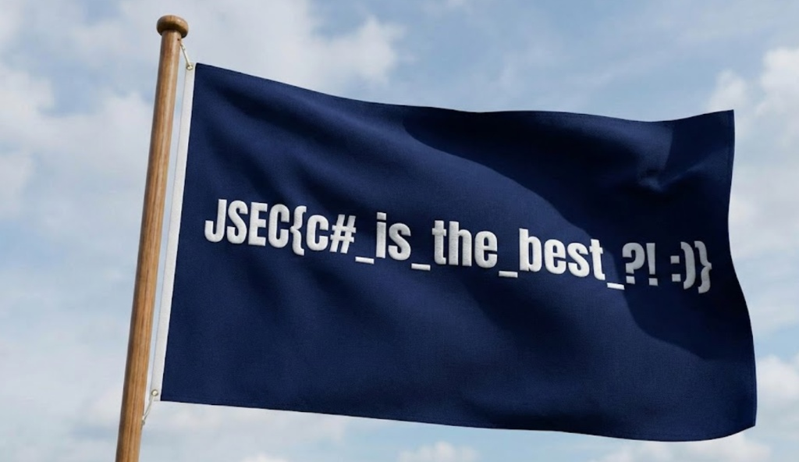

# The Will

A JordanSec CTF reverse engineering challenge involving an encrypted image embedded in a Windows .NET executable.

## Challenge overview

| Field | Detail |
| --- | --- |
| Challenge | The Will |
| Platform | JordanSec CTF |
| Category | Reverse engineering |
| Difficulty | Medium |
| Input | `The will.exe` |
| Output produced by the supplied solver | `flag.png` |

The objective was to analyze the executable, locate hidden data, and recover the image stored inside an encrypted resource. The original solution and recovered screenshot are preserved alongside this edited reading version.

## Identify the executable

Start by identifying the provided file:

```bash
file "The will.exe"
```

The original analysis identified a **PE32 executable for Microsoft Windows** and a **Mono/.NET assembly**. This made static inspection with ILSpy, dnSpy, or monodis a useful starting point.

## Inspect the embedded resource

Static inspection identified an encrypted resource named:

```text
The_will.Resources.f1.png.enc
```

The original notes recorded an offset of **552** and the following extraction command:

```bash
dd if="The will.exe" bs=1 skip=552 of=f1.png.enc
```

This offset belongs to the executable analyzed in the original writeup; it should not be assumed to apply to another build. The command copies from that offset to the end of the file. When reproducing the analysis, confirm the resource boundaries and length in the original executable rather than assuming all trailing bytes belong to the encrypted resource.

The original challenge binary, its download location, and its hash are not included in this repository. That prevents independent end-to-end reproduction until the original input is supplied.

## Recover the decryption parameters

The original decompilation notes describe **AES in CBC mode** with this challenge key:

```text
shadowpass123456
```

The supplied `sol.py` reads the first **16 bytes** of `f1.png.enc` as the IV and decrypts the remaining bytes. The payload must therefore be nonempty and aligned to the AES block size of 16 bytes.

## Run the supplied solution

Use Python 3 and install the dependency in an isolated environment:

```bash
python3 -m venv .venv
. .venv/bin/activate
python3 -m pip install -r requirements.txt
```

Place the extracted `f1.png.enc` next to the solver, run from that directory, then execute:

```bash
python3 sol.py
```

The original script already searches the decrypted bytes for the full PNG signature:

```python
png_header = b"\x89PNG\r\n\x1a\n"
start = decrypted.find(png_header)
```

If the signature is found, it saves the bytes from that point as **`flag.png`**. The extra repair command in the original narrative is unnecessary for this version of the solver. The filenames `fixed_flag.png` and `real_flag.png` in the older notes describe an earlier manual step; they are not outputs of the supplied script.

The algorithm in `sol.py` is preserved unchanged. It does not yet validate input size, handle missing-file errors, or return a distinct failure status when the PNG signature is absent. A success message and an image that can actually be opened should both be checked; a zero exit status alone does not confirm successful recovery.

## Recovered evidence

The image below is the result published with the original writeup. It is preserved without alteration; it is not presented as a newly reproduced run.



## Investigation flow

1. Identify the executable as a .NET assembly.
2. Inspect the executable’s embedded resources.
3. Extract the encrypted resource and confirm its boundaries.
4. Recover the AES-CBC key and IV handling from the decompiled logic.
5. Decrypt the resource and locate the PNG signature.
6. Save and inspect the recovered image.

## Tools and lessons

| Tool or technique | Purpose |
| --- | --- |
| `file` / `strings` | Initial file identification and inspection |
| ILSpy / monodis | .NET code and resource inspection |
| `dd` | Extraction using the recorded file offset |
| Python / PyCryptodome | AES-CBC decryption |
| PNG magic bytes | Locating the image within decrypted output |

Embedded resources can carry the interesting evidence even when the program’s visible logic does not. Identifying the runtime early helps choose suitable tools, while file signatures help distinguish a valid recovered format from arbitrary output.

## Source and reproducibility

The preserved files include the original `sol.py`, original screenshot, and `README.original.md`. Provenance and SHA-256 hashes are recorded in `provenance.json`.

To complete reproduction, the remaining requirements are the original challenge executable or its download link, its hash, and confirmation of the resource extraction boundaries. No new solve date, points, ranking, or verification claim has been added.
