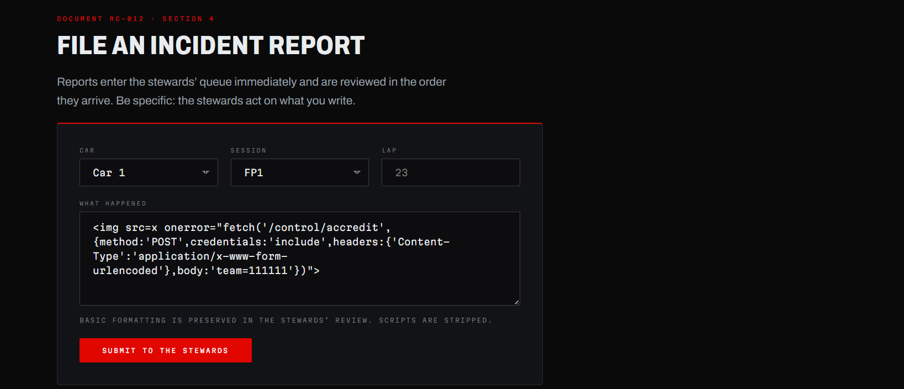
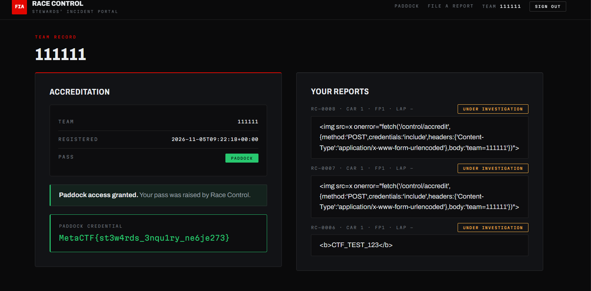

# FIA Race Control

## Challenge overview

| Field | Detail |
| --- | --- |
| Competition | MetaCTF |
| Category | Web exploitation |
| Reported weakness | Stored cross-site scripting leading to a privilege change |
| Team identifier shown in the challenge screenshots | `111111` |

The challenge uses a stewards’ incident-report portal. The supplied notes describe progressing from restricted team access to `PADDOCK` clearance by placing JavaScript in an incident report that would be reviewed by a privileged steward.

## Incident-report input

The first screenshot records an image event-handler payload submitted in the report’s description field:

```html

```

The payload targets the relative path `/control/accredit` and submits the team identifier as URL-encoded form data. The `credentials: 'include'` option is significant because the intended request runs in the context of the viewer’s authenticated browser session.

[](images/image1.png)

## Reported execution path

The source notes describe the following sequence:

1. Submit an incident report containing the payload.
2. Have the report processed in the privileged review workflow.
3. Send the accreditation request for team `111111` through that browser context.
4. Return to the team page and observe the updated clearance.

The submitted markup is shown as text in the team’s own report view. That does not by itself establish how the same content is handled in a different review interface. The original notes propose that the steward’s view renders it differently; no screenshot or implementation of that view was supplied. This part of the execution path is therefore reported reasoning, rather than independently captured evidence.

## Observed result in the supplied screenshot

The second screenshot directly shows:

- Team `111111` with a `PADDOCK` pass.
- The message **“Paddock access granted.”**
- A value in the **PADDOCK CREDENTIAL** field.

```text
MetaCTF{st3w4rds_3nqu1ry_ne6je273}
```

[](images/image2.png)

## Lessons learned

The writeup illustrates why stored user content must be handled safely in every interface that renders it, including staff review tools. A team-facing page displaying markup as text does not establish that a separate privileged viewer uses the same rendering path. The accreditation action also represents a separate authorization boundary.

## Source and reproduction scope

This reading version edits the supplied Arabic notes into formal English for the portfolio and preserves both embedded screenshots unchanged. The original Word document and extracted source text remain alongside it. The observed access state and flag are taken from the uploaded evidence; no live requests were sent to the competition service during publication.
