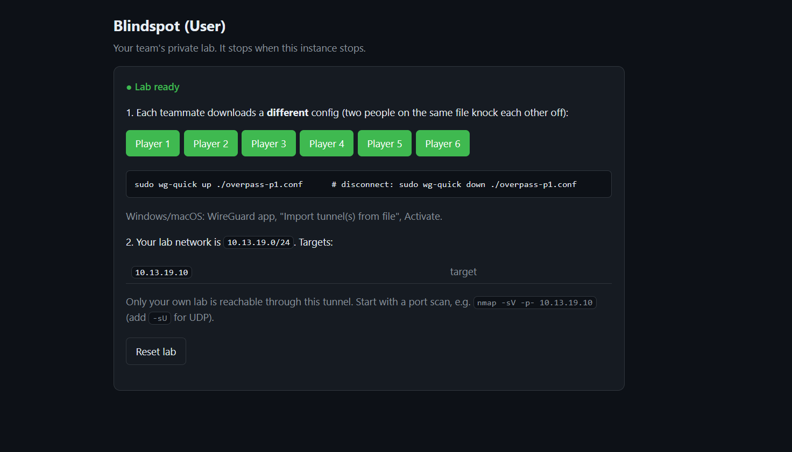
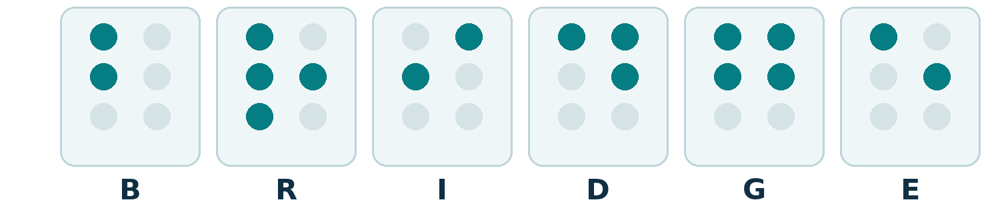
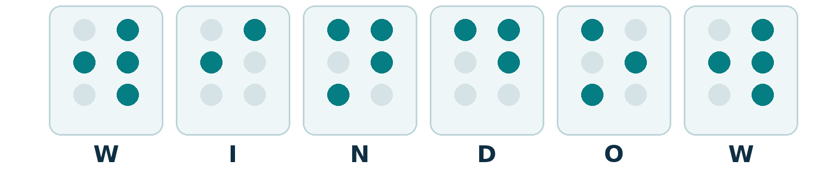
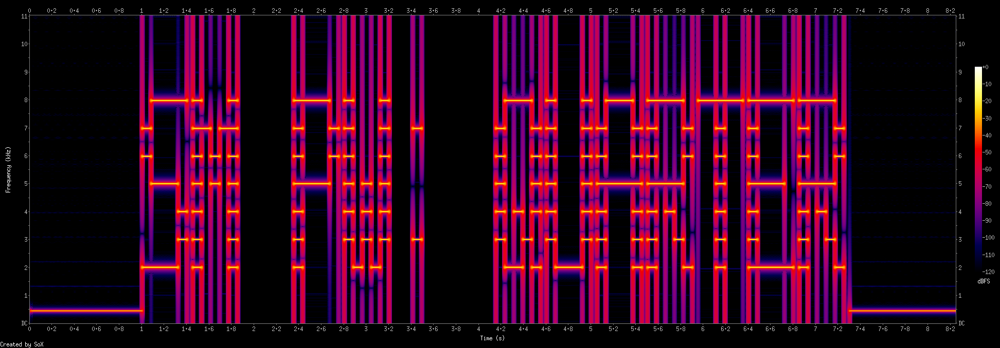

# Blindspot — User and Root

## Publication verification

This combined casefile covers two separately scored stages: User (166 points) and Root (205 points). The original walkthrough reports the SSH and root outcomes. Publication checks independently analyzed the supplied audio offline; no challenge instance was contacted. The embedded spectrogram matches the supplied audio and reveals `SM PW: QUARTER`, supporting the documented password `quarter`.

**CTF / MACHINE WRITE-UP**

**BLINDSPOT**

**USER + ROOT**

A complete, reproducible walkthrough of both challenge stages

The night watch leaves two trails: six-dot Braille on a web duty log, and a password embedded in an audio handover. The first grants an SSH foothold; the second unlocks the station master’s account.

| **CHALLENGE**        | **USER STAGE** | **ROOT STAGE**      |
|----------------------|----------------|---------------------|
| Difficulty           | Medium         | Medium              |
| Points               | 166            | 205                 |
| Target in solved lab | 10.13.19.10    | 10.13.13.10         |
| Goal                 | Read user.txt  | Read /root/root.txt |

**CHALLENGE CREDITS**

Machine author: fr1d4y \| Platform: Bracken CTF / Overpass \| Date: 20 November 2026

**VERIFIED OUTCOME**

| **USER ✓** Successfully authenticated as night_watch and retrieved the User flag. |
|-----------------------------------------------------------------------------------|

| **ROOT ✓** Successfully became UID 0 with su - and read /root/root.txt. |
|-------------------------------------------------------------------------|

**Scope:** The commands and addresses below relate to the team’s private CTF VPN labs. Instance IPs and per-watch passphrases can change after a lab reset.

**01 / ENVIRONMENT AND RECONNAISSANCE**

## Lab setup and attack surface

Each stage provisions a separate private Linux lab accessed through WireGuard. Kali Linux is the attacking machine. The challenge is solved against the instance-specific internal address shown by the lab page.

## Connecting from Kali


```text
sudo apt update

sudo apt install wireguard-tools -y

sudo wg-quick up ./overpass-p1.conf

sudo wg show
```


The Player 1 configuration was used for the User lab. A distinct Player 2 configuration (overpass-p2.conf) was used for the fresh Root lab. Each teammate must use a separate config. If changing labs, disconnect the old tunnel before enabling the new one.

## User lab portal



Figure 1. User-stage lab page showing WireGuard access and the target 10.13.19.10.

## Service discovery

| sudo nmap -Pn -sC -sV -p- 10.13.19.10 -oN blindspot_scan.txt |
|--------------------------------------------------------------|

| **PORT** | **DETECTED SERVICE**           | **SIGNIFICANCE**                |
|----------|--------------------------------|---------------------------------|
| 22/tcp   | OpenSSH 9.2p1 (Debian)         | Remote account login            |
| 8080/tcp | Werkzeug 2.2.2 / Python 3.11.2 | Lookout Station web application |

| **Key correction** The website’s sample SSH command mentions port 2222, but Nmap demonstrated that port 22 is open in the actual lab. |
|---------------------------------------------------------------------------------------------------------------------------------------|

**02 / BLINDSPOT (USER)**

## Web clue → Braille → SSH

## Step 1 — Enumerate the web application


```text
curl -i http://10.13.19.10:8080/

curl -i http://10.13.19.10:8080/duty-log

curl -i http://10.13.19.10:8080/hint
```


The home page identifies the account night_watch and says that the current shift’s SSH passphrase is posted on /duty-log in lower-case form. The page links to /hint as a legacy accessibility fallback.

The /hint route returned HARBOR, while /duty-log showed six SVG panels containing light (raised) and dark (inactive) dots. The direct, authoritative clue is the dot-cell log; do not confuse the legacy fallback with the decoded passphrase.

## Step 2 — Decode six-dot Braille



Figure 2. Raised-dot patterns decoded left to right: B R I D G E.

Braille cell positions are numbered 1–3 down the left column and 4–6 down the right. In the SVG, the pale circles are active; their dot positions map to letters using a standard Braille chart.

| **CELL** | **DOTS**   | **CHAR** | **CELL** | **DOTS**   | **CHAR** |
|----------|------------|----------|----------|------------|----------|
| 1        | 1, 2       | B        | 4        | 1, 4, 5    | D        |
| 2        | 1, 2, 3, 5 | R        | 5        | 1, 2, 4, 5 | G        |
| 3        | 2, 4       | I        | 6        | 1, 5       | E        |

## Step 3 — SSH login and User flag


```text
ssh night_watch@10.13.19.10 -p 22

## password: bridge

ls

cat user.txt
```


| OVERPASS{blindspot_user_njndhot52pw5o7e743zv} |
|-----------------------------------------------|

| **Result** The night_watch SSH session succeeded and user.txt yielded the exact User-stage flag shown above. |
|--------------------------------------------------------------------------------------------------------------|

**03 / BLINDSPOT (ROOT)**

## Fresh lab and a new foothold

The Root half starts a fresh instance. The original User password is not reusable: the new web duty log displays a different six-cell Braille passphrase. The observed Root-stage target was 10.13.13.10.

## Step 1 — Switch VPN and reconfirm services


```text
sudo wg-quick down overpass-p1

sudo wg-quick up ./overpass-p2.conf

sudo wg show

sudo nmap -Pn -sC -sV -p- 10.13.13.10
```


The second lab again exposed SSH on TCP/22 and the Werkzeug application on TCP/8080. The new tunnel’s allowed network was 10.13.13.0/24.

## Step 2 — Decode the new duty log

| curl -s http://10.13.13.10:8080/duty-log |
|------------------------------------------|



Figure 3. New instance, new Braille credential: W I N D O W.

| **CELL** | **DOTS**   | **CHAR** | **CELL** | **DOTS**   | **CHAR** |
|----------|------------|----------|----------|------------|----------|
| 1        | 2, 4, 5, 6 | W        | 4        | 1, 4, 5    | D        |
| 2        | 2, 4       | I        | 5        | 1, 3, 5    | O        |
| 3        | 1, 3, 4, 5 | N        | 6        | 2, 4, 5, 6 | W        |

## Step 3 — Re-enter as night_watch


```text
ssh night_watch@10.13.13.10 -p 22

## password: window

ls

cat README.txt
```


The home directory contained README.txt, handover.wav, and user.txt. The README explicitly identified the audio file as the source of the station-master password and instructed the user to authenticate using su -.

**04 / ROOT PASSWORD DISCOVERY**

## Audio handover → Spectrogram

## Step 4 — Inspect the handover note

| cat ~/README.txt |
|------------------|


```text
Night-watch handover.


See handover.wav for the station-master password.

The master prefers their creds posted on the duty log too, but the audio

is faster if you have a player with a spectrogram view.


Login to the station master account with: su -
```


This is the decisive escalation hint. The file is not an ordinary credential text file: the audio must be visualized to uncover the password message.

## Step 5 — Transfer and visualize the WAV

From a separate Kali terminal, transfer the file from the established SSH account. The observed WAV was a mono PCM audio file (16-bit, 22,050 Hz), approximately 8.30 seconds long.


```text
cd ~/Desktop

scp night_watch@10.13.13.10:/home/night_watch/handover.wav .

## enter the SSH password: window

sudo apt install sox libsox-fmt-all -y

sox handover.wav -n spectrogram -x 1800 -y 600 -o handover.png

xdg-open handover.png
```




Figure 4. Spectrogram of handover.wav: deliberate, sharply timed high-frequency tones carry the hidden message.

## Step 6 — Interpret the concealed instruction

Reading the spectrogram clue yields “SMPW: QUARTER”. “SMPW” denotes the station-master password, giving the lowercase password quarter. The subsequent successful su - authentication validated this interpretation.

| **Extracted credential** Station-master password: quarter (use lower-case for the successful login). |
|------------------------------------------------------------------------------------------------------|

**05 / PRIVILEGE ESCALATION AND PROOF**

## Root shell and flag

## Step 7 — Switch to the station-master account


```text
night_watch@b80882eaf8e9:~$ su -

Password: [quarter]

root@b80882eaf8e9:~# ls

root.txt

root@b80882eaf8e9:~# cat root.txt

OVERPASS{blindspot_root_3urt7mxdmh7f2tskkhb3}

root@b80882eaf8e9:~# id

uid=0(root) gid=0(root) groups=0(root)
```


The su - command opened a root login shell, confirmed by the root prompt and UID 0. The requested file /root/root.txt was then read successfully.

## Validated flags

| **STAGE**      | **FLAG**                                      |
|----------------|-----------------------------------------------|
| User — 166 pts | OVERPASS{blindspot_user_njndhot52pw5o7e743zv} |
| Root — 205 pts | OVERPASS{blindspot_root_3urt7mxdmh7f2tskkhb3} |

## End-to-end attack chain


```text
USER: WireGuard → nmap → web :8080 → /duty-log → Braille "bridge"

→ SSH night_watch → user.txt


ROOT: New WireGuard → new /duty-log → Braille "window"

→ SSH night_watch → README.txt → handover.wav

→ spectrogram → "SMPW: QUARTER" → su - → root.txt
```


## Troubleshooting and lessons learned

- Treat each stage as a fresh lab: the IP, tunnel, and duty-log password can change.

- Use service enumeration to resolve contradictory instructions: SSH was on TCP/22, not the sample port 2222.

- Read all six Braille positions carefully: an incorrect second cell caused an initial failed Root-stage login; the correct password was window.

- The legacy /hint route exposed HARBOR in the first lab, but the working, verified User-stage SSH credential came from Braille.

- Do not assume that Root-stage user.txt is the earlier User flag. In the observed fresh lab it contained a separate hash-like value.

- A spectrogram can encode text visually; inspecting WAV frequency-versus-time data revealed the escalation password.


## Source files

- [Original Word walkthrough](Blindspot_User_and_Root_CTF_Writeup.docx)
- [Original audio](handover.wav)
- [Offline verification record](verification.json)
- [Independently generated spectrogram](verified-spectrogram.png)
