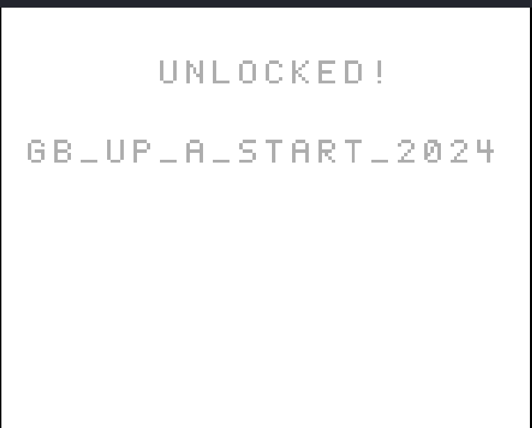

# GBPASS — Reverse Engineering Writeup

**Event:** OVERPASS 2026 — Qualifiers  
**Category:** Reverse Engineering  
**Target:** `gbpass.gb` (32 KiB DMG / Game Boy ROM)  
**Environment:** Kali Linux, Python 3, mGBA  
**Result:** Solved; flag accepted

**Flag:** `OVERPASS{GB_UP_A_START_2024}`

## Publication checks

The original ROM, both supplied writeup formats, and the original script are preserved. Reading the supplied ROM confirmed the tile-encoded message and all eight pair sums for the proposed button sequence.

**Correction:** the verifier call is at `$01D1`, its comparison at `$01D4`, and the `JR Z` instruction at `$01D6`. Its relative displacement is `$41`, so the actual success-routine entry is `$01D6 + 2 + $41 = $0219`. The original documents use addresses one byte earlier, and the original downloadable script stops at its branch-byte assertion. The reading version uses the corrected addresses, and a separate reviewed script applies `JP $0219` and recomputes the global checksum. That script was run on a copy; the original ROM remained unchanged.

The supplied image documents the author’s emulator result. No emulator playthrough was rerun for this publication, and the static button-sequence check is not an emulator acceptance test.

## 1. Challenge overview

The cartridge presents a single screen reading `LOCKED` / `ENTER 16`. The objective is to recover the sequence of 16 Game Boy button presses that passes the verification routine and reveals the win screen. We first reverse engineered the input validation and recovered a valid sequence under its constraints. Because automated key delivery did not yield a visible victory in mGBA, the confirmed solve used a separate copy of the ROM patched to jump to the existing success routine. The win screen displayed `GB_UP_A_START_2024`, and submitting it as `OVERPASS{GB_UP_A_START_2024}` was accepted.

## 2. Reconnaissance and ROM entry point

```bash
file gbpass.gb
# Game Boy ROM image: "GBPASS" (Rev.00) [ROM ONLY], ROM: 256Kbit

xxd -g 1 -s 0x100 -l 0x100 gbpass.gb
strings -a -t x -n 4 gbpass.gb
```

The file command identifies a 256-Kbit / 32-KiB DMG ROM. At offset `$0100`, the cartridge executes a `NOP` and jumps to `$0150`:

```asm
0100: 00          nop
0101: C3 50 01    jp $0150
```

`strings` revealed the `GBPASS` title but not the eventual secret. The victory message is represented by Game Boy tile indices rather than printable ASCII.

## 3. Joypad input and RAM layout

The main loop invokes `$0276` to read the Game Boy joypad register at `$FF00` (P1/JOYP). It tracks newly pressed buttons and stores the next 16 presses into work RAM.

| Address | Role |
|---|---|
| `$FF00` | Joypad hardware register |
| `$0276` | Joypad read routine |
| `$C001`–`$C010` | Sixteen recorded button values |
| `$C020` | Press counter |
| `$C021` | Previous joypad state |
| `$03BB` | Entry of verification routine |

Because the routine swaps and combines the register nibbles, the recorded button values are:

| Button | Value | Button | Value |
|---|---|---|---|
| A | `0x01` | Right | `0x10` |
| B | `0x02` | Left | `0x20` |
| Select | `0x04` | Up | `0x40` |
| Start | `0x08` | Down | `0x80` |

## 4. Reverse engineering the verification routine

The routine at `$03BB` first checks the endpoints of the recorded sequence:

```asm
03BB: FA 01 C0    ld a, ($C001)   ; first press
03BE: FE 40       cp $40          ; Up
03C0: C2 B9 03    jp nz, $03B9    ; reject otherwise
03C3: FA 10 C0    ld a, ($C010)   ; sixteenth press
03C6: FE 08       cp $08          ; Start
03C8: C2 B9 03    jp nz, $03B9
03CB: C3 72 03    jp $0372       ; further validation
```

The loop at `$0372` compares mirrored pairs of input values with eight bytes stored at ROM offset `$03D6`. In zero-based notation, for `i = 0..7`:

```text
(input[i] + input[15 - i]) & 0xFF == expected[i]
```

The table obtained by `xxd -g 1 -s 0x3d6 -l 8 gbpass.gb` is:

```text
48 41 A0 A0 42 41 90 90
```

The first pair is `Up (0x40) + Start (0x08) = 0x48`. The rest can be solved by matching one-button bit masks, respecting the endpoint checks. One candidate that satisfies all eight comparisons is:

```text
01 Up       02 A        03 Left     04 Down
05 B        06 Up       07 Right    08 Down
09 Right    10 Down     11 A        12 Up
13 Left     14 Down     15 Up       16 Start
```

The eight calculated sums, in order, are `48 41 A0 A0 42 41 90 90` — an 8/8 static verification. This establishes a valid sequence for the recovered checks; it does not claim the physical-button run was successfully demonstrated in the emulator.

## 5. Confirmed solution: patch to the win routine

The normal success path is reached through a conditional relative branch at `$01D6`:

```asm
01D1: CD BB 03    call $03BB
01D4: FE 01       cp $01
01D6: 28 41       jr z, $0219
```

At `$019C`, the input loop originally executes `CALL $0263` (`CD 63 02`). Replacing those three bytes with `JP $0219` (`C3 19 02`) makes a fresh copy of the ROM enter the same success routine once initialization finishes.

```python
from pathlib import Path

rom = bytearray(Path('gbpass.gb').read_bytes())
assert rom[0x019C:0x019F] == bytes.fromhex('CD 63 02')
assert rom[0x01D6:0x01D8] == bytes.fromhex('28 41')
rom[0x019C:0x019F] = bytes.fromhex('C3 19 02')  # JP $0219
Path('gbpass_unlocked.gb').write_bytes(rom)
print('Created gbpass_unlocked.gb')
```

```bash
python3 gbpass_solve.reviewed.py
mgba-qt gbpass_unlocked.gb
```

The short excerpt above illustrates the branch change; the downloadable reviewed script also checks the ROM layout and updates its global checksum.

This is a deliberate **verification bypass**, not proof that the 16-button sequence was entered. It preserves the original `gbpass.gb` and changes only the copy. The patched cartridge displayed `UNLOCKED!` with `GB_UP_A_START_2024`.

## 6. Decode the win-screen tiles

The victory text is stored as numeric tile IDs around offsets `$03FE`–`$040F`. The visible alphabet follows `1 = A`, `2 = B`, ..., `26 = Z`; digit indices start at `$1B = 0`, and `$27` denotes `_`.

```python
rom = Path('gbpass.gb').read_bytes()
def decode(v):
    if 1 <= v <= 26: return chr(ord('A') + v - 1)
    if 0x1B <= v <= 0x24: return str(v - 0x1B)
    if v == 0x27: return '_'
    return f'<{v:02X}>'

print(''.join(map(decode, rom[0x03FE:0x0410])))
# GB_UP_A_START_2024
```

The challenge page specified the wrapper `OVERPASS{...}`. With that wrapper, the submitted flag was accepted:

```text
OVERPASS{GB_UP_A_START_2024}
```

## 7. Lessons learned

- For unfamiliar architectures, start with the ROM entry point and the hardware input register, then trace the RAM writes.
- A verification function can use relationships between inputs rather than comparing every input to a literal secret.
- Static verification of the mathematical constraints and dynamic confirmation in the emulator are different forms of evidence; report them separately.
- A small, validated change to a branch target can reveal a victory screen while keeping the original binary untouched.
- On Game Boy ROMs, text may be encoded as tile indices, so `strings` can miss important messages.

**Final status:** flag accepted; success screen confirmed using binary patching.


## Source files and supplied emulator evidence

[](images/image1.png)

- [Original Game Boy ROM](gbpass.gb)
- [Reviewed patch script](gbpass_solve.reviewed.py)
- [Original supplied script, unchanged](gbpass_solve.py)
- [Original Markdown writeup](README.original.md)
- [Original Word writeup](GBPASS_Reverse_Engineering_Writeup.docx)
- [Publication verification record](verification.json)

Put the reviewed script beside `gbpass.gb` and run it with Python 3. It creates a separate `gbpass_unlocked.gb`; the original ROM is not overwritten. The screenshot is preserved from the supplied Word document. Challenge-platform acceptance is the author’s reported result, not a new submission made during publication.
