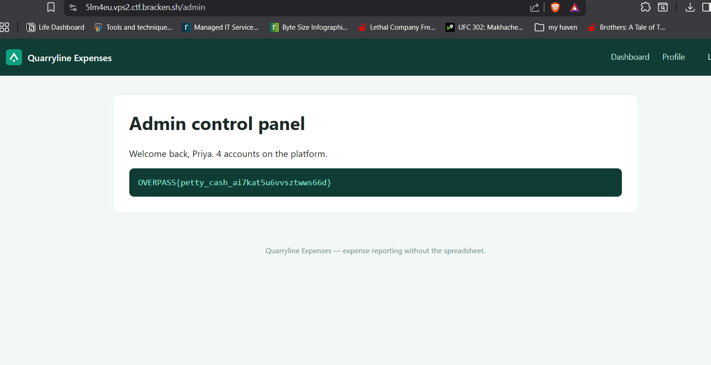

# Petty Cash

## Challenge overview

| Field | Detail |
| --- | --- |
| Event | OVERPASS 2026 — Qualifiers |
| Category | Web |
| Reported difficulty | Medium |
| Reported points | 200 |
| Application | Quarryline Expenses |

Quarryline’s finance team uses an internal application to submit and approve expense reports. The challenge describes approvals made by an account without the required rights. The objective was to reach the restricted `/admin` control panel and retrieve the flag.

The original challenge instance was `https://5lm4eu.vps2.ctf.bracken.sh`. The account names and routes below belong to that CTF instance.

## Initial reconnaissance

After registering an ordinary account, I inspected the authenticated routes in the browser:

| Route | Response | Observation |
| --- | --- | --- |
| `/dashboard` | `200 OK` | Accessible after login |
| `/profile` | `200 OK` | Profile update functionality |
| `/admin` | `403 Forbidden` | “Admins only” access check |
| `/expenses` | `404 Not Found` | No matching route |

The `/admin` route existed, but the initial request was denied. The dashboard identified the current account as `Role: user · Department: fbfg`.

## Finding the relevant input

The profile page exposed editable name and department fields, alongside a disabled text field. That suggested a useful question: did the server allow only the intended attributes, or did it also accept an unexpected authorization field?

The investigation tested a **mass-assignment** pattern by adding a hidden `role=admin` field to the ordinary profile form:

```javascript
const form = [...document.forms].find(
  f => f.querySelector('[name="department"]')
);
const role = document.createElement("input");
role.type = "hidden";
role.name = "role";
role.value = "admin";
form.appendChild(role);
form.requestSubmit();
```

The source also describes checking whether an equivalent parameter could be included in JSON or URL-encoded profile-update requests when the application submitted changes through JavaScript.

## Observed result and flag

A later visit displayed the administrator control panel rather than the earlier forbidden page. The supplied capture shows “Welcome back, Priya. 4 accounts on the platform.” and the following flag:

```text
OVERPASS{petty_cash_ai7kat5u6vvsztwws66d}
```

[](images/image1.png)

## Root cause and evidence boundaries

Accepting `role=admin` through a self-service profile update would let an ordinary user choose an authorization level. The tested pattern is mass assignment leading to broken access control.

The evidence establishes the final administrator page and visible flag. It does **not** establish the complete backend transition: the source identifies the earlier dashboard account as **Naim**, while the final administrator page welcomes **Priya**. The successful update response and any intervening account or session changes were not captured. The precise path from the submitted parameter to the final session therefore remains unproven by the supplied evidence.

## Recommended mitigations

- Allowlist editable profile attributes on the server, such as name and department.
- Reject or ignore authorization fields such as `role` and `is_admin` in self-service updates.
- Enforce administrator authorization at every protected endpoint and action.
- Audit role changes and test unexpected parameters in each supported request format.

## Source files

[Download the original Word writeup](Petty_Cash_CTF_Writeup.docx).

This reading version reorganizes the supplied document and preserves its screenshot, payload, flag, and evidence limitation. No requests were sent to the competition service during publication. The source reports the challenge as solved for 200 points; that value is not inferred from the team scoreboard.
